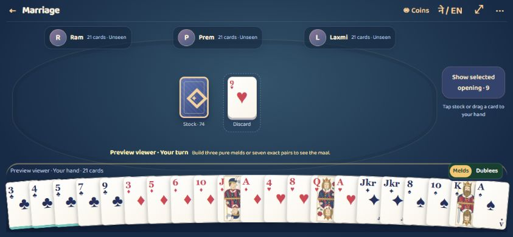

# Dashain Cards

Seven Nepali card games, one place to play and keep score. Built around the Dashain tradition of gathering around a table, with English and Nepali interfaces, offline bot games, online friends rooms and shared live scorekeepers.

**[Try the live app](https://www.techwiredsolutions.com.np/dashaincards)** · Version 1.9.0 · Android internal testing



[View the phone homepage](docs/screenshots/home.png)

[Call Break match rules](docs/CALL_BREAK.md) · [Internal Android release](docs/PLAY_RELEASE.md)

## Engineering focus

The project combines reusable rules engines with browser-local play and a
server-authoritative friends-room service. Important boundaries include legal
moves, concealed opponent cards, reconnect/state handling and configurable house
rules. Read [architecture](docs/ARCHITECTURE.md) for those decisions and
[Android setup](docs/ANDROID.md) for the development companion's current scope.

## Games and features

| Game | Players | Play and scoring |
| --- | --- | --- |
| Marriage | 2–5 | Melds, dublees, public tunnelas, editable maal rules and explained round settlements |
| Call Break | 3–4 | Five-round matches, editable rank stakes and 8-call rules; three players remove 2♥ |
| Dhumbal | 2–5; 6–7 as a house variant | Draw/discard, matching sets, optional runs and Jhyap |
| Dahar Mara | Exactly 4 | Two teams, trump, captured tens and kot scorekeeping |
| Kitti | 2–5 | Three private hands, showings and configurable winning rules |
| Faras | 2–17 | Blind/seen play, bets, raises, pack, show and carried virtual chip balances |
| Jutpatti | 2–6 | Pairs, optional wild cards and Jut declarations |

- Six-digit friends rooms for every game, with server-authoritative turns and concealed opponent hands.
- Shared score links: guests can read; the owner edits and can transfer ownership.
- Configurable house rules, point values and coin rates. Rule variants are labelled rather than presented as a universal ruleset.
- Offline bot play, saved games, local history and JSON backups.
- Game-specific virtual coin settlement; chips cannot be bought or redeemed for money.
- Portrait/landscape tables, drag-and-drop, tap alternatives, card movement and reduced-motion support.
- An Android WebView wrapper serving bundled assets through Android's app-assets origin.

## Run locally

Install Node.js 22 LTS or newer. The web app, local server and automated tests have no npm runtime dependencies.

```sh
git clone https://github.com/sudip-parajuli/dashain-cards.git
cd dashain-cards
npm start
```

Open **http://localhost:4173**. This serves the web frontend; its default friends endpoint is the live service. For isolated local multiplayer, use the local room server instead:

```powershell
# PowerShell
$env:LOCAL_ROOM_SERVICE='1'
$env:HOST='127.0.0.1'
node server/start.mjs
```

```sh
# macOS / Linux
LOCAL_ROOM_SERVICE=1 HOST=127.0.0.1 node server/start.mjs
```

Open **http://localhost:4174**. Use independent browser profiles/devices to create and join a test room. The development server stores rooms in memory; restarting it removes them. See [deployment](docs/DEPLOYMENT.md) for LAN and Internet hosting.

## Test and build

```sh
npm run security:check
npm test
npm run build
```

The current suite contains 167 tests covering rules, settlements, hidden-card boundaries, stale actions, live scores, durable restarts and animation transitions. Building copies `web/` to `dist/` and the Android assets folder; generated copies are intentionally untracked.

See [Android setup](docs/ANDROID.md) for the debug APK, and [architecture](docs/ARCHITECTURE.md) for the project structure.

## Project layout

```text
web/                  UI, rules engines, offline storage and service worker
server/               Local HTTP server, rooms and shared score records
deploy/cloudflare/    Worker router and durable room coordinator
android/              Android WebView host and resources
scripts/              Preview, asset build and debug APK packaging
tests/                Portable Node regression tests and APK asset verifier
docs/                 Architecture, deployment and Android guides
```

## Current limits

The Android app is a development build, not a published Play Store release. Physical-device lifecycle and accessibility testing remain ongoing. Bots use simple strategies. Faras sideshows and longer Marriage opening sequences are not implemented. Online seats wait for disconnected players; there is no automatic bot takeover. Rooms and score links are intended for trusted friends, not sensitive records or cash play. Offline coins and records are device-local and can be changed by the device owner.

## Contributing, security and licenses

Read [CONTRIBUTING.md](CONTRIBUTING.md), [SECURITY.md](SECURITY.md) and [third-party notices](THIRD_PARTY_NOTICES.md). No open-source license has been selected for the application code; public visibility alone does not grant reuse rights. The bundled Baloo 2 font retains its SIL Open Font License.

Built by **Sudip Parajuli / Techwired Solutions**. Support: hello@techwiredsolutions.com.np.

## Version 1.5.1

Desktop Jutpatti uses an overlapping curved hand and automatic pair/wild sorting. New deals default to the indicator rank for 2–3 players and the next higher rank for 4–6; Ace wraps to 2. The old lower-rank preference migrates to this automatic rule for new deals; active rounds retain their stored wild rank. Same, higher and no-wild variants remain configurable.

Cards can be discarded anywhere in the centre play area in Marriage, Dhumbal and Jutpatti; Call Break and Dahar Mara continue to use that area for legal trick plays. Existing turn/phase validation still applies.

New offline wallets start with 5,000 coins. Existing balances are preserved. Active users receive 150 coins automatically once per 24 hours; missed days do not accumulate. Rewards stay outside any committed game budget and cannot be claimed twice after reload. No ad reward integration is included.

## Version 1.5.0

Play setup now shows only the point rate or boot (no field for Faras). Complete saved defaults are used for all seven games; Marriage still starts with the Nepali preset. Change player counts, table budgets, card values and house variants in Game settings before play or from the table gear menu. Saving defaults never changes a deal already in progress; the next deal uses the saved defaults.

Settings gathers sound/music, profile, language, game defaults, About, support/privacy links and backups. An original synthesized pentatonic background loop and short UI/draw/discard/play/chip/turn/show/result cues run offline through Web Audio, without external sound assets. Music and effects have independent toggles/volumes plus a persistent master mute. Browser visibility and Android pause/resume events silence background audio. Sound starts only after a user gesture; unsupported audio never blocks gameplay. Local bots pause while a settings dialog is open; online rooms continue independently.

## Version 1.5.1

The original Dashain Dhun arrangement uses a warm reed-style lead, sustained tonic/fifth and gentle six-beat percussion inspired by Mangal/Malashree dhun textures. It is a new composition, not a transcription or sampled recording. [SAC Music's Mangal Dhoon catalogue](https://sacmusicinternational.com/release/sarang-an-instrument-of-the-panchhe-baja/) was consulted for instrumental context. Card draws, discards and deals now use synthesized broadband paper swishes and light contact sounds instead of pitched note cues.

Marriage landscape fills the available viewport, reserves a separate full-width player rail, and keeps the hand, status and side actions in distinct rows. Exposed cards have opaque ivory faces and strong red/black ranks; extra rows scroll within their own meld panel. Android landscape tables hide system bars, which can be revealed by a swipe; leaving the table restores them. Games in the home navigation scrolls directly to the seven game tiles, including when navigating from another screen.

## Version 1.6.0

In-app privacy, professional incoming support address, unified custom rules without third-party preset branding, strict shared-score rule validation, secure deck randomness, HTTPS-only release builds, and per-room real-time infrastructure. See [security review](docs/SECURITY_REVIEW.md) and [capacity assessment](docs/CAPACITY.md) for verification and limits.

## Version 1.6.1

The supplied The Auspicious Call recording is the default looping background music, bundled for offline web/Android playback. Settings keeps music controls without the previous descriptive caption. Existing mute and volume preferences are preserved.

## Version 1.7.0

Every game now opens with a shuffle/deal sequence and celebrates completed deals with a winner overlay and sound. Jutpatti centres its stock with a face-up indicator partly beneath it, Faras moves its controls beside the hand, and Kitti groups cards in the hand area before three turn-based showings. New Kitti rooms require all players to update to this version. Reveals start beside the dealer in the configured direction; the first showing’s winning seat leads the remaining showings (ties use the first tied seat in reveal order). Existing Kitti overall scoring is unchanged, with settlement deferred until the final reveal. Reduced-motion and sound preferences are respected.

## Version 1.7.1

Kitti now keeps a single hand with separated three-card bundles. Choose two sets; the final three cards form the last set automatically. Drag the eligible bundle onto the table to reveal it (tapping or keyboard activation is an accessible alternative). Revealed sets leave the hand, and each completed showing animates the public cards toward its winner before the final celebration. Online reveals validate the selected set index and preserve hidden-set privacy.

Gameplay changes and supported rules: [Gameplay refinements](docs/GAMEPLAY_REFINEMENTS.md).
